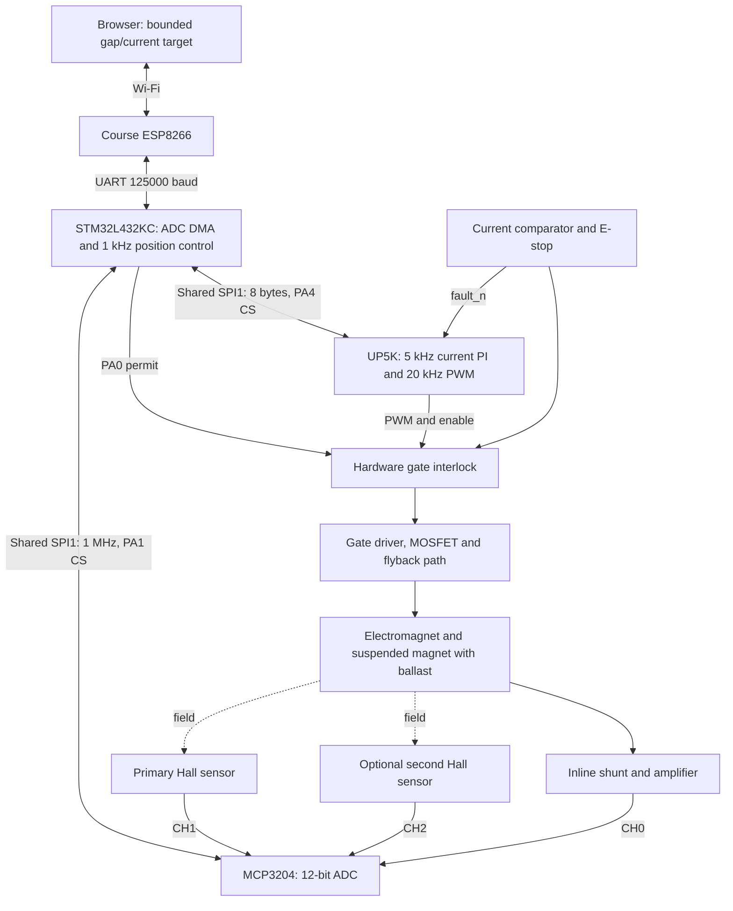

# Implementation and control design

This implementation follows the detailed **shared-control option 2** in [the updated team proposal](../Project%20Proposal.docx). The alternative FPGA position controller is not selected. The target is a permanent magnet with ballast below an electromagnet, with sustainable suspension and visible commanded motion at gaps no greater than 10 mm. These are hardware acceptance goals, not demonstrated software results.

## Subsystems

The MCU owns both SPI chip selects and performs sensor/current compensation, filtered velocity estimation, position PI/PID, bounded target motion, and UART/web service. The FPGA performs signed fixed-point current PI using DSP blocks, coherent packet validation/status, a separate 50 ms watchdog, 20 kHz PWM, and latched fault gating. Default firmware readiness flags, FPGA commissioning, and gains remain disabled/zero.

## Position sensing and motion

Gap is positive downward from the coil. The local estimator is

`gap_mm = c0 + c1*H1_counts + c2*H2_counts + c3*measured_current_A`.

Set `hall_sensors=1` for CH0/CH1 scans with current compensation and `c2=0`; use `hall_sensors=2` for CH0/CH1/CH2 scans and the full calibrated fit. `tools/calibrate.py --hall-sensors 1` supports a single-Hall CSV without a second Hall column. Independent holdout validation is still required. Symmetry and opposite sensor orientation do not guarantee electromagnetic field cancellation; fitted coefficients must establish the actual polarity and response.

The MCP3204 offers **pseudo-differential** inputs: IN- must stay within 100 mV of ground. Two DRV5055 outputs centered near half supply cannot be connected as a differential pair. Consequently this implementation reads both channels single-ended and combines them digitally. True differential acquisition would require suitable analog conditioning or a different ADC. See section 4.1 of the [manufacturer datasheet](https://ww1.microchip.com/downloads/aemDocuments/documents/APID/ProductDocuments/DataSheets/21298e.pdf).

The MCU runs every fifth scan with `e = measured_gap - ramped_target`:

`Irequest = clamp(Ihover + Kp*e + Kd*filtered_velocity + integral, 0, Imax)`.

Positive error or falling motion requests more lift. Derivative acts on measurement, with initialization to avoid kick; integral uses conditional anti-windup. Gap commands are bounded and slew-limited. The supplied example interval is 8-10 mm with 1 mm/s target motion and a 10 mm/s filtered velocity trip. These values require measurements; they are not calibrated plant limits. Current-test mode ramps current separately with the object supported. Additional permanent magnets and any separate velocity loop require characterization before use.

ADC channels are sampled sequentially, with current first. Packet pairing preserves the scan association, but cannot remove interchannel aperture skew or PWM ripple. Measure compensation error with the target clamped while changing coil current. Moving averages, coil-off sampling, lookup tables, and alternate optical/ultrasonic sensing remain possible future changes, not claimed features.

## Current controller and shutdown

The FPGA updates PI once for each accepted fresh current pair, nominally every 200 us. Kp and Ki use Q8.8; Ki already includes 0.0002 s. Signed products/sums and the integrator are bounded; duty clamps to 0-1080 of 1200 clocks (90%). Seven arithmetic stages finish in less than 0.3 us at 24 MHz. Duty changes at PWM boundaries. Disabling clears PI history. Compiled gains live in `project_config.svh` and must be tuned for the new update period.

Serial CRC takes 48 clocks (2 us); registered validation adds a few more clocks. Status is refreshed every 64 FPGA clocks and frozen for an SPI transaction. Faults latch for external interlock, measured overcurrent, and 50 ms without fresh commands. Invalid or repeated packets cannot refresh the watchdog or repeat an integrator update. Safe disabled commands can clear faults; enabling and clearing are separate actions. See [the wire contract](protocol.md).

MCU permit and external fault gate the physical output immediately, independently of packet processing. ADC DMA errors/stalls/overruns remove permit and halt acquisition until reset. Telemetry checksum or previous-sequence acknowledgment failure also stops MCU control. The separate comparator/E-stop is essential because a plausible stuck ADC code is not digitally distinguishable from a steady input.

## Timing budget

| Item | Calculation | Nominal result |
|---|---|---|
| Sampling/current updates | 1 / 5000 | 200 us |
| Position updates | every fifth scan | 1 kHz |
| ADC conversion | 24 clocks / 1 MHz | 24 us per channel |
| One-Hall scan, proposal ideal | 2 x (24 + 1) us | 50 us |
| Two-Hall scan, proposal ideal | 3 x (24 + 1) us | 75 us |
| FPGA exchange | 64 clocks + 2 us lead + 2 us trail | 68 us |
| Two-Hall bus budget, proposal ideal | 75 + 68 us | 143 us; 57 us remainder |
| PWM | 24 MHz / 1200 | 20 kHz; 50 us period |
| Current resolution, example | 3.3 V / 4096 / (0.1 ohm x 20) | 0.403 mA/count |
| Shunt dissipation at 0.5 A | I squared R | 25 mW |
| UART useful rate | 125000 / 10 | 12500 bytes/s |

The driver also inserts ADC CS setup time and incurs DMA interrupt, CRC, and controller execution time. Thus 143 us is the proposal's ideal wire budget, not a measured implementation duration. Measure worst-case scan completion, including the fifth-sample control calculation, before commissioning. Completion past the next 200 us release is a fault. Capture actual SCK, CS timing, PWM phase, and current/Hall apertures. MCU and FPGA use separate clocks; scans are not locked to PWM phase. No stability or simultaneous-sampling claim follows from these nominal rates.

TIM2 provides a free-running 1 MHz timestamp; TIM6 releases ADC scans at 5 kHz. DMA1 RX interrupts advance current/Hall conversions, execute every-fifth-scan position control, pack the current pair, and handle FPGA feedback. Foreground code handles nonblocking USART1 and HTML using a brief interrupt-protected state snapshot. The 5-second browser lease is enforced in the sampling path even if foreground page service stops.
