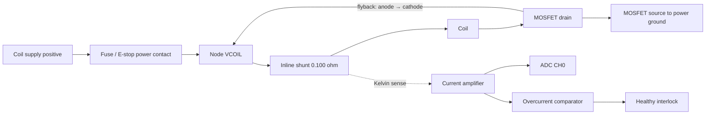

# Candidate hardware and proposed wiring

Nothing in this document asserts an assembled circuit. Use the course boards; all other items are candidates. Keep `power_stage_ready=false`, `calibration_ready=false`, and `LEV_COMMISSIONED=0` until the corresponding bring-up gates pass.

## Parts and early decision

- One or two **TI DRV5055 linear analog Hall sensors**, initially evaluate A3 or A4 sensitivity. Set `hall_sensors` in firmware to match the installed count; an absent CH2 should be grounded. Choose the full ordering code/package after measuring field range. These are analog sensors, not magnetic switches. Power them at 3.3 V with local 100 nF bypassing; use the same quiet rail for the ADC reference. The [manufacturer datasheet](https://www.ti.com/lit/ds/symlink/drv5055.pdf) specifies the transfer range, orientation, and bandwidth. Verify package pin numbering; TO-92 and SOT-23 differ.
- One **MCP3204-CI/P** 12-bit ADC at 3.3 V, with CH0 current, CH1 primary Hall, CH2 reference Hall, and unused CH3 tied to analog ground. See the [MCP3204 datasheet](https://ww1.microchip.com/downloads/en/DeviceDoc/21298e.pdf). The MCU drives this ADC on SPI1, sharing clock/data lines with the FPGA and using a separate chip select.
- One **INA240A1** amplifier, gain 20, and a **0.100 ohm precision shunt** in series with the coil. At 3.3 V, ground both REF inputs for unidirectional measurement. Account for zero-current output headroom/offset in calibration. Its [datasheet](https://www.ti.com/lit/ds/symlink/ina240.pdf) describes common-mode behavior and PWM rejection. An SOIC adapter or assembled board is needed if using a bare IC.
- A MOSFET with verified on-resistance at the actual gate voltage, a gate driver such as **UCC27511**, and a flyback diode rated above coil current and supply/transient voltage. Driver inputs, supply bypassing, and gate discharge follow its [datasheet](https://www.ti.com/lit/ds/symlink/ucc27511.pdf). A 5 V driver supply is a candidate, subject to the selected MOSFET.
- A separate current-limited coil supply, fuse, physical E-stop, current comparator, output logic, and a nonmagnetic frame with a catch tray. Coil voltage/current, fuse, diode/clamp, MOSFET, threshold circuit, and thermal ratings remain contingent on the coil.

Start with an instructor-approved stockroom coil or one inexpensive test coil. Determine the usable gap with a force measurement and temperature test. A manufacturer's holding force at contact does not establish levitation capacity. Check whether a permanent-magnet object rotates, sticks to the core, or produces ambiguous Hall readings. A steel-only object requires a different field identification experiment before this estimator can be adopted.

The [candidate BOM](../hardware/bom.csv) contains budget allowances, not live supplier quotes. Replace all allowance values with dated quotes, full ordering numbers, stockroom availability, shipping, and tax before submitting or purchasing. The course currently marks the purchasing policy as under construction; confirm it with the instructors.

The MCP3204 pseudo-differential IN- input must remain within 100 mV of ground; do not directly connect two mid-supply Hall outputs as a differential pair. This design combines separate single-ended measurements digitally.

## Logic wiring

These are **explicit jumper connections**, with MCU–FPGA bridge DIP switches open. Confirm continuity against the [E155 board schematic](https://hmc-e155.github.io/assets/doc/E155%20Development%20Board%20Schematic.pdf). FPGA numbers are SG48 silicon pad labels printed as `Pxx`/`GPIO_xx`, not UPduino header contact numbers. Avoid connecting two outputs together.

| Signal | MCU pin / Nucleo label | FPGA pad | Other endpoint |
|---|---|---:|---|
| Shared SCK | PA5 / A4 | 23 | MCP3204 CLK pin 11 |
| FPGA CS active low | PA4 / A3 | 25 | 10k pull-up to 3.3 V |
| Shared MOSI | PA7 / A6 | 26 | MCP3204 DIN pin 9 |
| Shared MISO | PA6 / A5 | 27 | MCP3204 DOUT pin 10 |
| ADC CS active low | PA1 / A1 | - | MCP3204 CS pin 8; 10k pull-up |
| MCU permit active high | PA0 / A0 | 34 | hardware interlock; external 10k pulldown |
| UART TX | PA9 / D1 | - | ESP RX (3.3 V) |
| UART RX | PA10 / D0 | - | ESP TX (3.3 V) |
| External healthy / fault_n | - | 43 | hardware interlock, active high healthy |
| PWM | - | 36 | output logic then gate driver |
| FPGA gate enable | - | 42 | output logic |
| Accepted current packet debug | - | 38 | scope/logic analyzer, nominal 5 kHz |

Former FPGA ADC pads 31, 32, 35, and 37 are unused. Rewire the ADC to MCU SPI1 before using this revision. Both unselected peripherals must release MISO.

All signal grounds share a reference; keep coil current out of ADC/sensor ground wiring. Logic is 3.3 V. Verify the Nucleo A4/A5 solder-bridge arrangement and I2C pull-up/loading on your board; no I2C is used here. The mikroBUS socket may already route the course ESP UART correctly; check RX/TX labels and the board's TX selection jumper rather than adding duplicate wiring.

MCP3204 DIP: CH0 pin 1, CH1 pin 2, CH2 pin 3, CH3 pin 4, NC pins 5/6, DGND 7, CS 8, DIN 9, DOUT 10, CLK 11, AGND 12, VREF 13, VDD 14. Bypass VDD and VREF near the IC. Add only an RC network that settles within the ADC acquisition time; choose it from the source-impedance calculation and measured bandwidth. Pin numbers follow Table 3-1 of the manufacturer datasheet; MCP3208 has a different pinout.

## Power circuit connectivity

The [netlist](../hardware/netlist.md) defines the circuit nodes. This is a design sketch; it must become a labeled KiCad schematic using the selected packages and ratings before the final report.

**The flyback diode cathode connects to VCOIL before the shunt.** That places both coil and shunt inside the recirculation loop, so off-time current is measured. A shunt placed only in the supply lead outside that loop does not measure recirculating current. The diode protects the MOSFET but yields slow decay; measure whether this is adequate. Replacing it with a higher-voltage clamp requires rechecking MOSFET/common-mode/supply stress and retuning.

Hardware must force the driver inactive whenever PWM is low, FPGA enable is low, MCU permit is low, or the physical interlock is unhealthy. For example, use 3.3 V AND logic to combine these conditions into the driver's noninverting input; tie its inverting input low. Keep a gate-source pulldown and logic-input pulldowns so an unconfigured FPGA cannot energize the coil. The physical E-stop also opens coil power. Derive `fault_n` from the E-stop auxiliary contact and an overcurrent comparator with a defined safe default; its exact schematic/threshold depends on the chosen current limit. Never tie `fault_n` permanently high in the powered levitator.

For the numerical example, 0.5 A produces about 1.0 V at the current amplifier, or 1241 ADC counts. A **separate comparator threshold** must be established from actual offsets, gain tolerance, and thermal/current ratings. FPGA sampling is not a substitute for this physical cutoff. Software shutdown removes drive; stored magnetic energy still decays through the flyback path.
