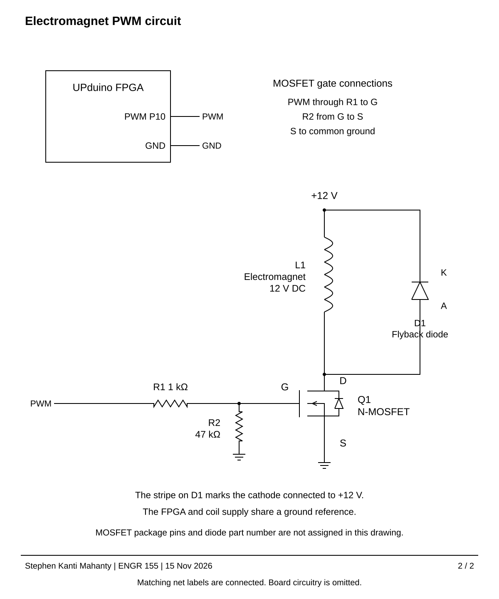

## Assembled test setup

CAD parts have been drafted, iterated, printed, and assembled to hold the electromagnet and sensors in a testable setup. Revisions address actual component fit, sensor position adjustment, soldered-wire access, and mounting hardware. The [progress report](progress.qmd#mechanical-design-and-fabrication) shows CAD views of the adjustable-holder and front common-rod iterations.

The CAD incorporates the D68-N52 moving magnet and DC1 helper disks. The final helper arrangement, moving mass, sensor positions, and polarity must be recorded with the calibration. The proposal's 10 g mass and 10–20 mm gap remain demonstration targets.

## Components in the current work

| Function | Current hardware | Evidence and next check |
|---|---|---|
| MCU readout | STM32L432KC | Fixed-byte reception reported; 16-bit live readout in progress |
| ADC interface and PWM | UPduino v3.1 | Connected to ADC and MOSFET test circuit |
| Hall sensing | Two DRV5056-family devices | Wired and tested at different magnet positions; installed A3/A4 positions to be recorded |
| Analog conversion | MCP3204 | Hall outputs connected to CH0/CH1; read by FPGA |
| Electromagnet | Heyiarbeit JF-XP2520-12V, nominal 25 mm × 20 mm | Received and tested with MOSFET/PWM; force and thermal characterization pending |
| Low-side switch | 2N7000 used in the small-electromagnet test | AO3400A selected for a larger coil; identify the installed device for each run |
| Gate network and flyback | Latest drawing: 1 kΩ series, 47 kΩ gate-to-source, diode across coil | Circuit tested; final diode part number and switching measurements to be recorded |
| Structure | Printed frame, head, cassette, and sensor mounts | Physical setup assembled and CAD iterated |

The DRV5056 identification and FPGA-owned ADC connection supersede the DRV5055/MCU-ADC descriptions on earlier pages. The latest schematic does not establish an installed INA240 current sensor, shunt, separate gate driver, or overcurrent comparator. Those proposal components should not be assumed present.

## Current schematic

{fig-alt="Low-side MOSFET electromagnet switching circuit driven by FPGA pad 10 with a flyback diode."}

The coil uses a 12 V supply; FPGA logic and supply share ground. The flyback diode cathode is on +12 V and its anode is at the MOSFET drain. The gate is driven from FPGA pad 10 through the series resistor. Earlier pad-36 experiments used a different test build.

See the [sensing sheet and ADC pin map](progress.qmd#two-spi-interfaces), download the [editable schematic document](assets/progress-report/maglev_schematic.docx), or open the [diagram bundle](assets/progress-report/maglev_diagrams.zip).

## Characterization still required

Record force versus gap and duty/current using the complete magnet assembly, together with coil resistance, operating temperature, Hall headroom, and repeated position measurements. Approximate supply readings during a sweep are useful observations but do not establish rated coil current or lift at the intended gap. Sustained operation also needs evaluation with the actual printed material and mounting arrangement.

The [candidate BOM](hardware/bom.csv), [earlier netlist](hardware/netlist.md), and proposal budget are historical planning records. The current schematic and progress report document the bench revision; a final as-built parts list and purchase total remain to be compiled.
