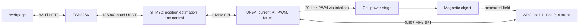

## Abstract

This project design pairs the course STM32L432KC and UPduino v3.1 to control the gap beneath an electromagnet. The MCU combines two Hall measurements with coil current to estimate position and calculate a bounded current request. The FPGA acquires analog signals, regulates coil current, generates PWM, and supervises timing and faults. A webpage served through the course ESP8266 selects gap targets and displays operating state.

**Development status:** the digital implementation, documentation, and automated tests are prepared. Physical parts are not selected, and levitation performance is not measured. Output is disabled in default builds. This page is a development report; it does not claim a finished levitator.

## System architecture

See the [implementation](docs/design.md) for loop equations, routine responsibilities, timing, and limitations, and the [hardware guide](docs/hardware.md) for candidate parts and wiring. The object/coil combination and Hall observability must be established experimentally before committing the proposed operating interval.

## What is implemented

| Subsystem | Implementation |
|---|---|
| MCU | CMSIS register drivers, 1 ms scheduler, calibrated local Hall estimator, filtered velocity, PD/PID with anti-windup, bounded targets, web request handling |
| FPGA | Three-channel MCP3204 sequencer, signed fixed-point PI, period-boundary PWM updates, CRC/sequence validation, command/ADC watchdogs, latched faults |
| Operator interface | Height/current-test modes, arm/clear/stop, raw and engineering-unit telemetry, 5-second browser lease |
| Development | C behavior tests, HDL integration testbench, offline calibration and holdout tests, course deliverable drafts |

Use the [build guide](docs/build.md), [protocol](docs/protocol.md), and [bring-up sequence](docs/bringup.md) to reproduce the design. Source files are included in the repository and in the rendered site's downloadable `firmware` and `fpga` resources.

## New hardware

Candidate components are linear analog Hall sensors, an MCP3204 ADC, inline current sensing, and an interlocked MOSFET coil driver. Their roles and integration constraints are explained in the [hardware guide](docs/hardware.md). The [candidate bill of materials](hardware/bom.csv) contains planning allowances awaiting quotes and stockroom confirmation; it is not a final purchase list.

## Results and remaining experiments

Automated results and their limits are listed in [validation](docs/verification.md). Suspension duration, height accuracy, settling, disturbance rejection, actual timing, and temperature are **not measured**. The [checkoff record](docs/checkoff.md) defines the experiments needed to establish those results. A blank [measurement log](data/results/measurements.csv) is supplied for factual observations.

The principal risk is observing height while coil current changes. The [calibration procedure](docs/calibration.md) requires independent reference measurements and holdout sweeps, including fixed-object current steps. A successful static numerical fit alone does not establish stable feedback.

## Team, acknowledgements, and demonstration media

Team biographies and individual links have not been provided. Add the actual team information and contributions before final submission. No photos or demonstration video exist yet; add genuine build photographs and the course-hosted video after hardware testing, using the instructor's naming/submission requirements. Do not substitute simulated results for physical demonstrations.

The implementation was prepared with Codex assistance. Course and manufacturer references are credited in [references](docs/references.md); add actual people who helped the project. See the [course evidence map](docs/course.md) for proposal, review, midpoint, and final-report preparation.
