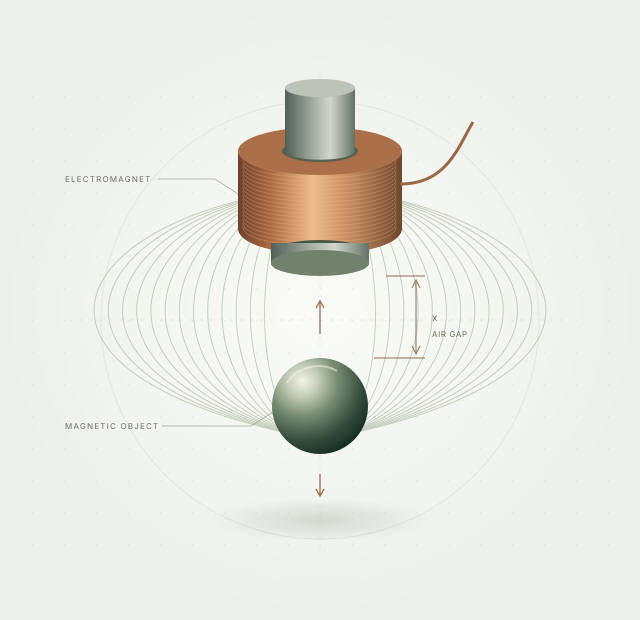

```{=html}
<section class="hero site-width" aria-labelledby="hero-title">
  <div class="hero-copy">
    <p class="eyebrow">ENGR 155 / EMBEDDED SYSTEMS</p>
    <h1 id="hero-title">Holding space.<br><span>Closing the loop.</span></h1>
    <p class="hero-description">A magnetic levitation experiment at the intersection of sensing, silicon, and control.</p>
    <p class="hero-detail">One electromagnet. Two control loops. A design that turns magnetic measurements into a precisely timed response.</p>
    <div class="hero-actions"><a class="action primary" href="design.html">Explore the design <span aria-hidden="true">↗</span></a><a class="action text-action" href="results.html">View the evidence <span aria-hidden="true">→</span></a></div>
    <div class="development-note"><span class="status-mark" aria-hidden="true"></span><span>Implementation stage <span class="note-divider">/</span> Hardware validation ahead</span></div>
  </div>
  <figure class="field-figure">
    <div class="figure-topline"><span>01 / THE LEVITATION CONCEPT</span><span aria-hidden="true">+ &nbsp; +</span></div>
    
    <figcaption><span>Magnetic attraction ↑ &nbsp; Gravity ↓</span><span>Concept illustration · not a prototype</span></figcaption>
  </figure>
</section>
<section class="spec-strip site-width" aria-label="Nominal design rates">
  <div><span class="spec-number">1 <span>kHz</span></span><span class="spec-label">Position loop / STM32</span></div>
  <div><span class="spec-number">10 <span>kHz</span></span><span class="spec-label">Current loop / FPGA</span></div>
  <div><span class="spec-number">20 <span>kHz</span></span><span class="spec-label">PWM / power stage</span></div>
  <p>Designed update rates.<br><a href="docs/design.html#nominal-timing-and-performance-calculations">See timing assumptions ↗</a></p>
</section>
<section class="intro-section site-width">
  <p class="eyebrow">THE IDEA</p>
  <div><h2>A balancing act,<br>every millisecond.</h2><p class="large-copy">Magnetic suspension is an unstable equilibrium. Pull too hard and the object rises into the coil. Pull too little and gravity takes over.</p><p>This project explores that balance with Hall sensing and nested feedback. The STM32 estimates the gap and requests current. The UPduino regulates that current and supervises the output independently.</p><a class="inline-link" href="design.html">Follow the control loop <span aria-hidden="true">→</span></a></div>
</section>
<section class="architecture-section" aria-labelledby="architecture-title">
  <div class="site-width">
    <div class="section-heading"><div><p class="eyebrow">INSIDE THE SYSTEM</p><h2 id="architecture-title">Different jobs.<br>One feedback loop.</h2></div><p>Select a stage to explore how the design senses, decides, and responds.</p></div>
    <div class="system-explorer" data-tabs>
      <div class="system-tabs" role="tablist" aria-label="Control loop stages">
        <button id="tab-sense" role="tab" aria-selected="true" aria-controls="panel-sense" tabindex="0"><span class="tab-number">01</span>Sense<span class="tab-meta">Hall sensors + ADC</span></button>
        <button id="tab-estimate" role="tab" aria-selected="false" aria-controls="panel-estimate" tabindex="-1"><span class="tab-number">02</span>Estimate<span class="tab-meta">STM32L432KC</span></button>
        <button id="tab-regulate" role="tab" aria-selected="false" aria-controls="panel-regulate" tabindex="-1"><span class="tab-number">03</span>Regulate<span class="tab-meta">UPduino v3.1</span></button>
        <button id="tab-protect" role="tab" aria-selected="false" aria-controls="panel-protect" tabindex="-1"><span class="tab-number">04</span>Protect<span class="tab-meta">Independent interlock</span></button>
      </div>
      <div class="explorer-panels">
        <div id="panel-sense" role="tabpanel" aria-labelledby="tab-sense" tabindex="0"><span class="panel-symbol" aria-hidden="true">◎</span><div><p class="eyebrow">THREE ANALOG CHANNELS</p><h3>Measure the field. Account for the current.</h3><p>Two linear Hall sensors and an inline current sensor feed a 12-bit MCP3204. The FPGA sequences all three channels into a coherent scan. Separating object motion from the coil’s own field is the first experimental challenge.</p><a href="hardware.html">Explore the sensing hardware →</a></div></div>
        <div id="panel-estimate" role="tabpanel" aria-labelledby="tab-estimate" tabindex="0" hidden><span class="panel-symbol" aria-hidden="true">x̂</span><div><p class="eyebrow">1 kHz / POSITION CONTROL</p><h3>Translate a field into a gap.</h3><p>The STM32 combines both Hall readings with measured current using a calibrated local model. Filtered velocity and a bounded position controller produce the next current request. Calibration coefficients and gains await physical measurements.</p><a href="mcu.html">Read the MCU design →</a></div></div>
        <div id="panel-regulate" role="tabpanel" aria-labelledby="tab-regulate" tabindex="0" hidden><span class="panel-symbol" aria-hidden="true">∿</span><div><p class="eyebrow">10 kHz / CURRENT CONTROL</p><h3>Make every switching cycle count.</h3><p>A fixed-point PI controller on the FPGA compares requested and measured current. Duty updates land at PWM period boundaries; autonomous acquisition and packet checks continue independently of the MCU.</p><a href="fpga.html">Read the FPGA design →</a></div></div>
        <div id="panel-protect" role="tabpanel" aria-labelledby="tab-protect" tabindex="0" hidden><span class="panel-symbol" aria-hidden="true">⊣</span><div><p class="eyebrow">OUTPUT SUPERVISION</p><h3>A missed deadline means stop.</h3><p>Command and ADC watchdogs, latched faults, MCU permission, and a proposed physical interlock supervise the coil. Default builds keep output disabled. Clearing a fault and arming the system are separate actions.</p><a href="docs/bringup.html">Review the bring-up sequence →</a></div></div>
      </div>
    </div>
  </div>
</section>
<section class="site-width reading-section">
  <div class="section-heading"><div><p class="eyebrow">PROJECT NOTEBOOK</p><h2>From first principles<br>to the workbench.</h2></div><a class="inline-link" href="documentation.html">All documentation ↗</a></div>
  <div class="chapter-grid">
    <a class="chapter" href="mcu.html"><span class="chapter-index">01 / FIRMWARE</span><h3>The position<br>controller.</h3><p>Estimation, timing, trajectories, and the operator interface.</p><span class="chapter-bottom">MCU design <span aria-hidden="true">↗</span></span></a>
    <a class="chapter" href="fpga.html"><span class="chapter-index">02 / DIGITAL LOGIC</span><h3>The current<br>controller.</h3><p>ADC sequencing, fixed-point regulation, PWM, and watchdogs.</p><span class="chapter-bottom">FPGA design <span aria-hidden="true">↗</span></span></a>
    <a class="chapter" href="hardware.html"><span class="chapter-index">03 / PHYSICAL SYSTEM</span><h3>Where code<br>meets the coil.</h3><p>Candidate components, circuit connectivity, and the bench plan.</p><span class="chapter-bottom">Hardware & materials <span aria-hidden="true">↗</span></span></a>
  </div>
</section>
<section class="site-width evidence-band"><div><p class="eyebrow">EVIDENCE, WITH CONTEXT</p><h2>Designed. Simulated.<br>Next: measured.</h2></div><div><p>The repository records passing software and HDL checks, plus a routed FPGA implementation. Levitation, thermal behavior, and physical timing have not yet been measured.</p><a class="action primary" href="results.html">Read the verification record <span aria-hidden="true">↗</span></a></div></section>
```
