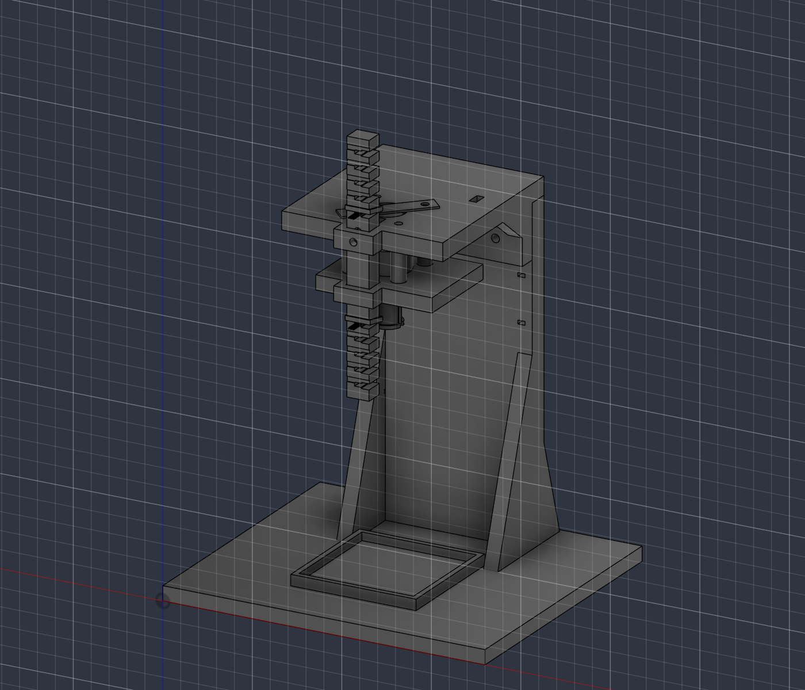
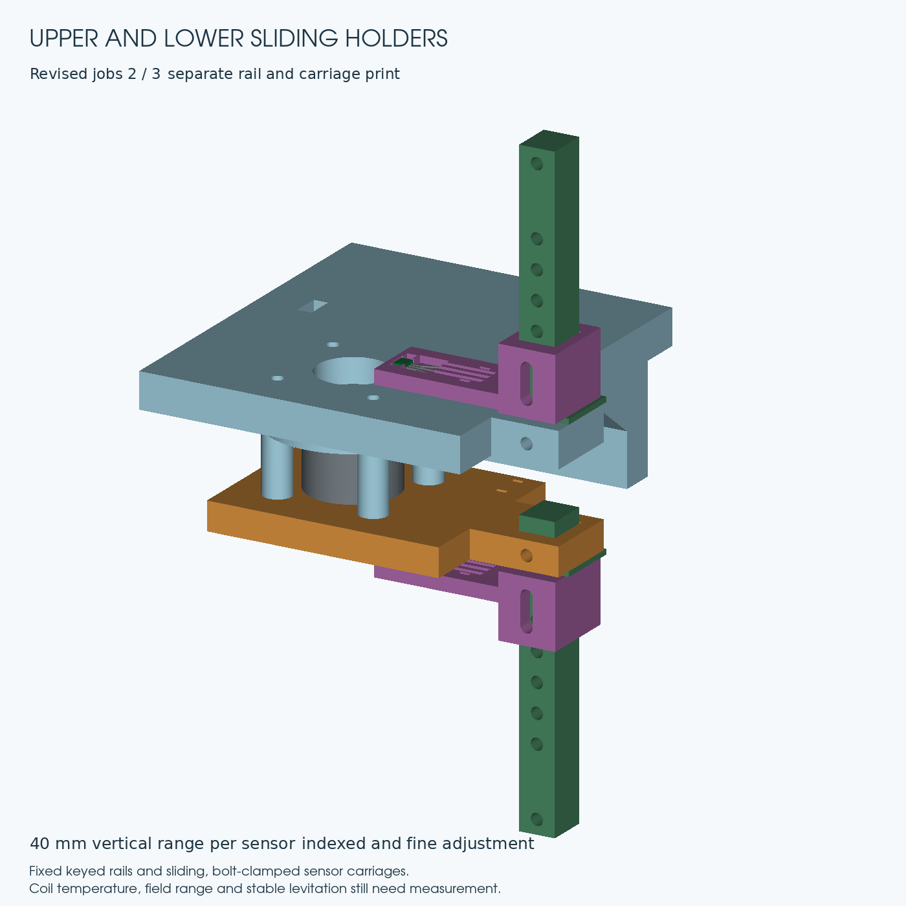
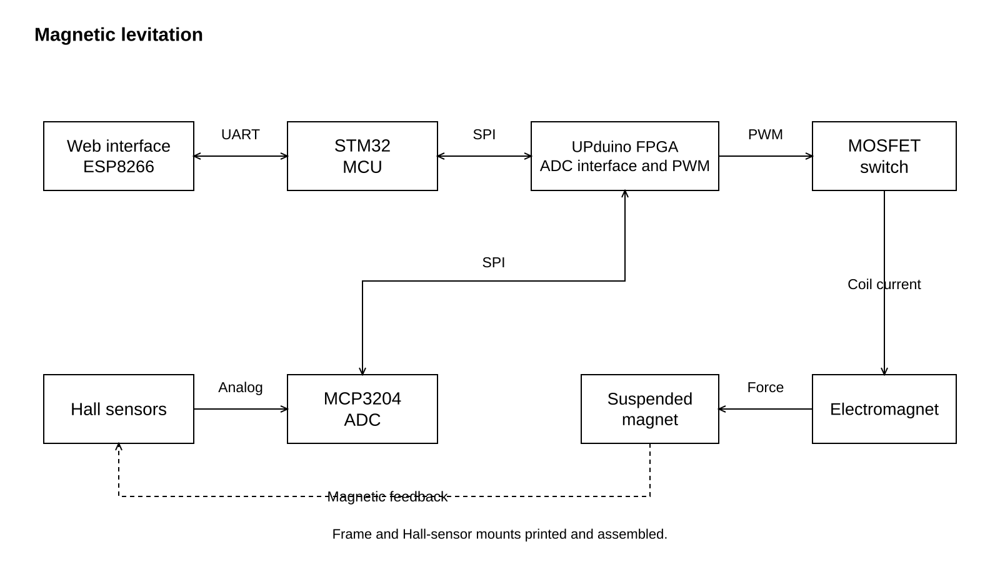
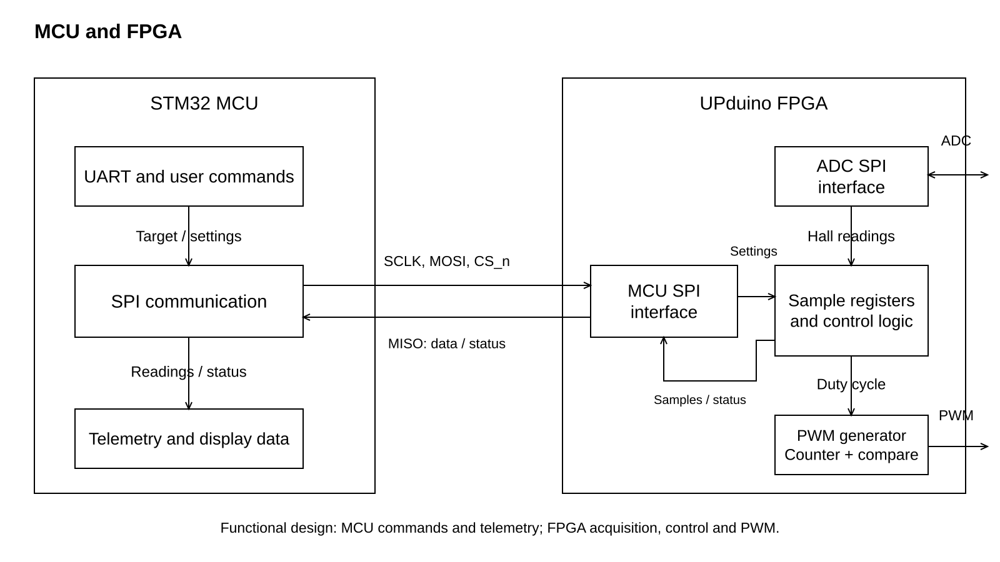
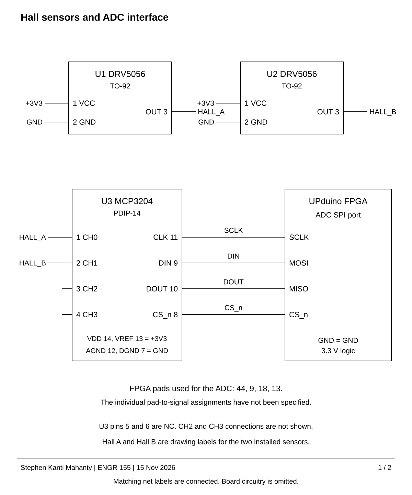
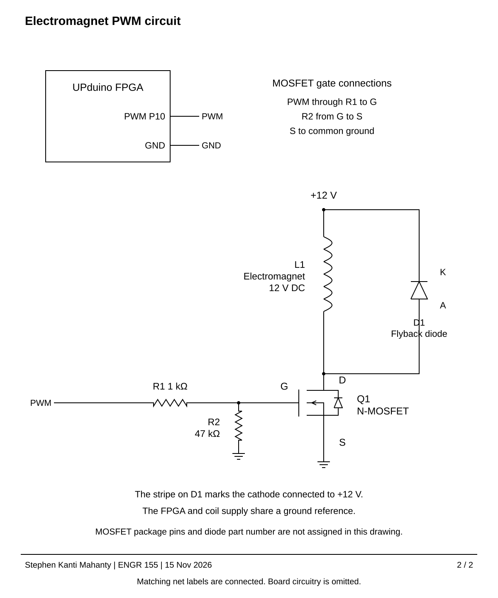

Since submitting the proposal, we have moved from selecting an architecture to building and testing its main subsystems. We drafted and iterated the mechanical CAD, printed and assembled a test setup, received components, wired and tested the Hall sensors and ADC, and exercised the electromagnet with a MOSFET and a sweeping PWM signal. We have also written MCU and FPGA code, prepared a basic design-review presentation, and updated the schematic to match the bench setup.

The current focus is connecting reliable sensor acquisition to the MCU–FPGA link and then integrating feedback control. The sensing and actuation experiments establish useful subsystem progress; stable free levitation remains the next system-level objective.

## Progress since the proposal

| Area | Work completed | Work in progress |
|---|---|---|
| Mechanical setup | CAD drafted and revised; frame and mounts printed and assembled into a testable setup | Further fit, sensor-position, and wiring-access iterations |
| Components | Parts ordered, received, and used in assembly and bench tests | Final installed-part record and characterization |
| Hall sensing | Two Hall sensors wired to the ADC; responses read at different magnet positions and with different data widths | Repeatable readings, noise reduction, and position calibration |
| ADC and SPI | FPGA-side ADC acquisition and two-channel subtraction code; MCU receive code extended to 16-bit words | Reliable end-to-end transfer and interpretation of live samples |
| Electromagnet drive | MOSFET switching circuit assembled and tested using a sweeping FPGA PWM signal, with flyback diode and gate components | Force, current, temperature, and switching measurements |
| Design review | Basic presentation, system diagrams, internal MCU/FPGA diagram, and updated schematic prepared | Feedback, combined operation, and closed-loop testing |

## Mechanical design and fabrication

We designed a stand to hold the electromagnet, position the Hall sensors, and provide a repeatable region in which to test the moving magnet. The CAD includes the base and upright, electromagnet head, helper-magnet cassette, moving-magnet carrier, and sensor holders. Printed parts are now assembled into a physical test setup.

The geometry has been revised as the actual components and assembly constraints became clearer. Early versions used generic sensor mounts. Later versions fitted the purchased DRV5056 packages and provided space for their leads and soldered connections. We then explored independently adjustable upper and lower holders and a front common-rod arrangement. These revisions make sensor position easier to change and improve access when installing or removing wired sensors.

::: {.column-page}
::: {layout-ncol=2}
{#fig-cad-front fig-alt="CAD model of the stand with a front rod carrying upper and lower Hall sensors."}

{#fig-cad-adjustment fig-alt="CAD detail showing upper and lower sensor carriages on separate vertical rails."}
:::
:::

The CAD work has therefore become part of the experimental process: changing sensor position or magnet placement can be tested on a supported assembly rather than with loose components. A position change also changes the measured field, so the final sensor configuration will be fixed before collecting the calibration dataset.

## Parts received and put to use

The project has progressed beyond a candidate parts list. The electromagnet, Hall-sensor hardware, ADC, switching components, magnets, and mounting hardware are being used in the build and tests.

| Subsystem | Current components and use |
|---|---|
| Computing | STM32L432KC MCU and UPduino v3.1 FPGA for communication, acquisition, and PWM work |
| Magnetic sensing | Two DRV5056-family Hall sensors connected to MCP3204 channels CH0 and CH1 |
| Actuation | Heyiarbeit JF-XP2520-12V electromagnet and a low-side N-channel MOSFET switching circuit |
| Switching tests | 2N7000 used in the small-electromagnet test; AO3400A selected for a larger coil |
| Magnets and mounting | CAD fitted to the D68-N52 moving magnet, DC1 helper disks, printed supports, and revised fasteners |

The latest drawings identify the Hall family as **DRV5056**, replacing the DRV5055 name used on older website pages. CAD accommodates the A3/A4 package variants; the final record still needs to identify which installed sensor occupies each position. The proposal BOM and budget remain historical planning documents rather than a final receipt total.

## Hall sensors, ADC, and data width

The two Hall outputs are physically wired to **MCP3204 CH0 and CH1**, pins 1 and 2. We have tested their response with a magnet at different positions and read out the resulting magnetic-field-dependent values. These are ADC readings; converting them into calibrated magnetic field or distance requires sensor scaling and measurements of the complete assembly.

The current FPGA acquisition code reads the two channels and forms a subtraction. The sensing experiment is being developed alongside the SPI readout so that the MCU can inspect the FPGA's measurement. A difference between the two channels is useful to investigate, but it does not by itself establish cancellation of the electromagnet field, particularly when the sensors have different sensitivities or positions.

We have also worked with different bit widths during debugging. They describe different parts of the data path:

| Width | Meaning in this work |
|---|---|
| 12 bits | Native MCP3204 conversion result |
| 8 bits | Earlier SPI test pattern and a reduced-width readout explored during development; also the PWM duty command width |
| 16 bits | Current MCU–FPGA SPI transfer container, allowing a complete ADC result to be transported |

A 16-bit transfer does not turn the ADC into a 16-bit converter. Signed subtraction, overflow behavior, and a stable measurement word during transfer still need to be defined and checked. Recent no-magnet debug output varied substantially, so repeatability, acquisition timing, and transfer framing remain active debugging work. Bypass capacitance and supply/reference wiring have also been discussed as part of improving the readout; their installation and effect have not yet been recorded as a measured result.

## Two SPI interfaces

The updated bench architecture places the **ADC SPI master in the FPGA**. The MCU is master on a separate SPI connection to the FPGA. This supersedes the earlier proposal diagram in which the MCU acquired the ADC through DMA.

{#fig-current-block fig-alt="Current magnetic levitation system block diagram with Hall sensors, ADC, FPGA, MCU, and electromagnet drive."}

The earlier standalone test returned decimal **165**, or **0xA5**, from the FPGA to the MCU. We have since written a 16-bit MCU receive routine and FPGA word sender and connected the ADC readout path in the FPGA top module. Successful reception of live samples still needs repeatability checks; the earlier fixed-byte result alone does not validate the complete acquisition path.

The current MCU test uses SPI mode 0, MSB first, at a nominal **125 kHz**, and exposes the received value as `fpga_word` for debugger inspection. The debug loop reads roughly twice per second. It is a bring-up loop, so this polling rate is not a demonstrated control-loop rate.

{#fig-internal-block fig-alt="MCU and FPGA internal functional diagram with the ADC SPI interface, MCU SPI interface, and PWM path."}

The following assignments come from the current [FPGA constraints](fpga/pwm_sweeper/pins.pcf). The sensing drawing lists the four ADC pads without mapping each one to a signal; this table supplies the mapping in the source. Physical continuity still needs checking against the programmed build.

| Connection | FPGA signal | FPGA pad | Other endpoint |
|---|---|---:|---|
| ADC clock | `adc_clk` | 44 | MCP3204 CLK, pin 11 |
| ADC select | `adc_cs` | 13 | MCP3204 CS, pin 8 |
| FPGA to ADC data | `adc_mosi` | 18 | MCP3204 DIN, pin 9 |
| ADC to FPGA data | `adc_miso` | 9 | MCP3204 DOUT, pin 10 |
| MCU SPI clock | `mcu_clk` | 21 | STM32 PB3, SPI1 SCK |
| MCU SPI select | `mcu_cs` | 20 | STM32 PA11, manual CS |
| FPGA to MCU data | `mcu_miso` | 12 | STM32 PB4, SPI1 MISO |
| Electromagnet PWM | `pwm` | 10 | MOSFET gate resistor |

## Electromagnet and PWM testing

We assembled and tested a low-side MOSFET circuit for the electromagnet. The coil connects to the 12 V supply and the MOSFET drain, while the source connects to the common ground. The FPGA drives the gate through a resistor. A gate-to-source resistor pulls the gate down, and a flyback diode across the coil provides a recirculation path when the MOSFET switches off.

The latest schematic shows a **1 kΩ gate series resistor**, a **47 kΩ gate-to-source resistor**, and PWM on **FPGA pad 10**. The diode cathode connects to +12 V and its anode to the drain. Earlier fixed-frequency experiments used pad 36; those pin assignments should not be mixed with the current sweeper build.

The FPGA sweeper varies an 8-bit duty value up and down to exercise the output stage without position feedback. Bench discussion reported supply current rising to approximately **28 mA** and falling during the sweep, with input power around **0.34 W** near the reported maximum. These are approximate observations from the sweeping test rather than a rated coil-current or force measurement. They establish progress on actuation testing, while lifting force, thermal behavior, and a validated high-frequency switching waveform remain to be characterized.

## Updated schematic and design review

We prepared a basic design-review presentation and diagrams at several levels: a system overview, a more detailed block diagram, and a compact view of the MCU and FPGA internals. The updated two-sheet schematic records the Hall-to-ADC wiring and the electromagnet power stage. It follows the current bench connections rather than the proposal's earlier ADC ownership and assumed current-sense/driver hardware.

::: {.panel-tabset}
### Hall sensing

{fig-alt="Updated sensing schematic showing two DRV5056 Hall sensors, MCP3204 pin names, and the FPGA ADC SPI connection."}

### Electromagnet drive

{fig-alt="Updated power schematic showing FPGA pad 10, a 1 kiloohm gate resistor, 47 kiloohm pulldown, MOSFET, 12 volt coil, and flyback diode."}
:::

Download the [two-sheet schematic](assets/progress-report/maglev_schematic.docx), [complete diagram bundle](assets/progress-report/maglev_diagrams.zip), or [more detailed system diagram](assets/progress-report/maglev_block_detailed.svg). The drawings show the documented wiring; unspecified MOSFET package pins and diode part number still need to be added to the installed-part record.

## Code written and next integration steps

The current bench source includes the [FPGA top module](fpga/pwm_sweeper/top.sv), [ADC interface](fpga/pwm_sweeper/adc_spi.sv), [word sender](fpga/pwm_sweeper/spi_byte_tx.sv), [duty sweeper](fpga/pwm_sweeper/sweep_8bit.sv), [PWM generator](fpga/pwm_sweeper/pwm.sv), and [MCU receive program](simple_byte/main.c). The older full-application firmware and HDL remain in the repository, but their earlier simulations do not establish that the present bench configuration is integrated or stable.

Our next steps are to make the two-channel readout repeatable, check coherent 16-bit transfers, calibrate the readings against known positions, and measure the electromagnet's usable actuation range. We can then connect the sensing path to the control law, tune the complete system, and test sustained levitation and commanded motion. Timing, position accuracy, temperature, and shutdown behavior will be reported from those measurements.

[Results and evidence](results.qmd) | [Current system design](design.qmd) | [Proposal baseline](docs/proposal.qmd)
